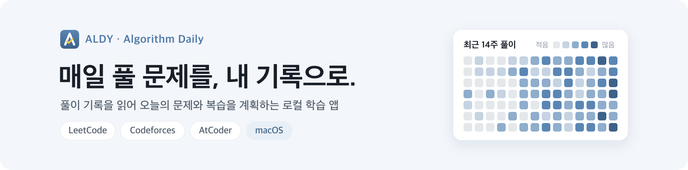
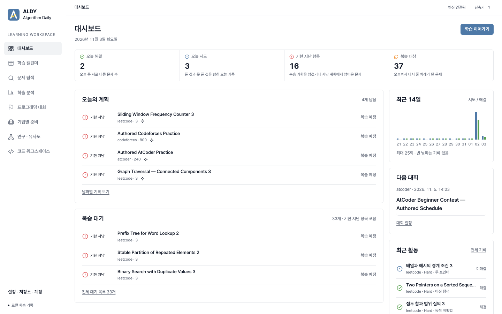
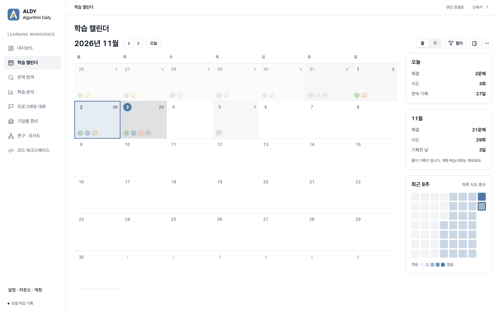
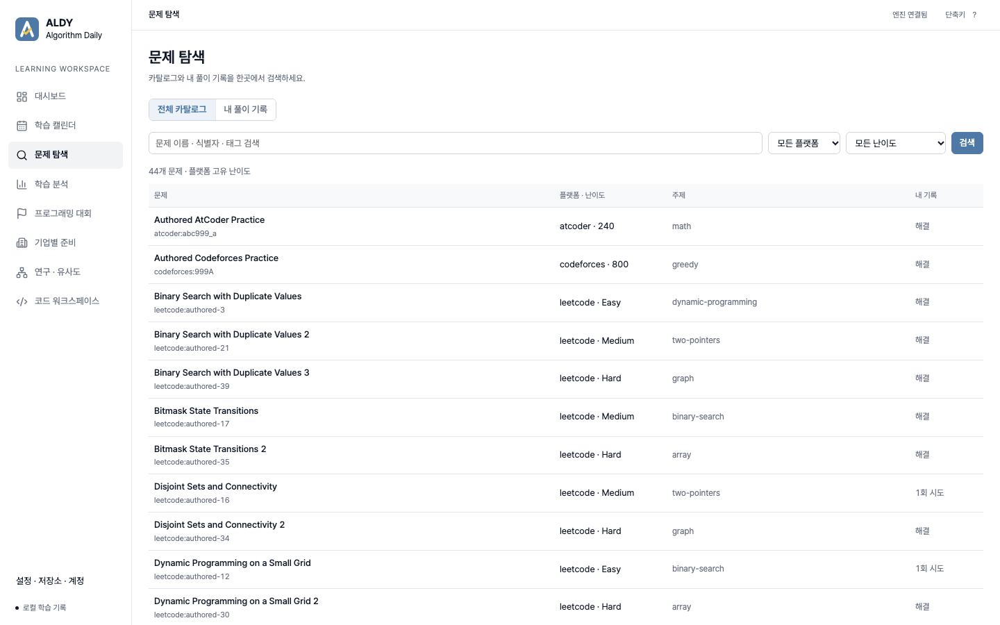
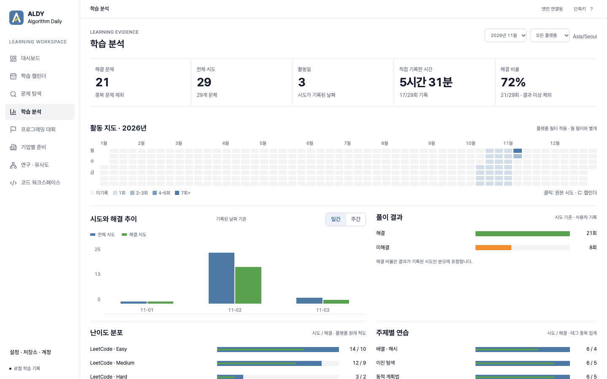
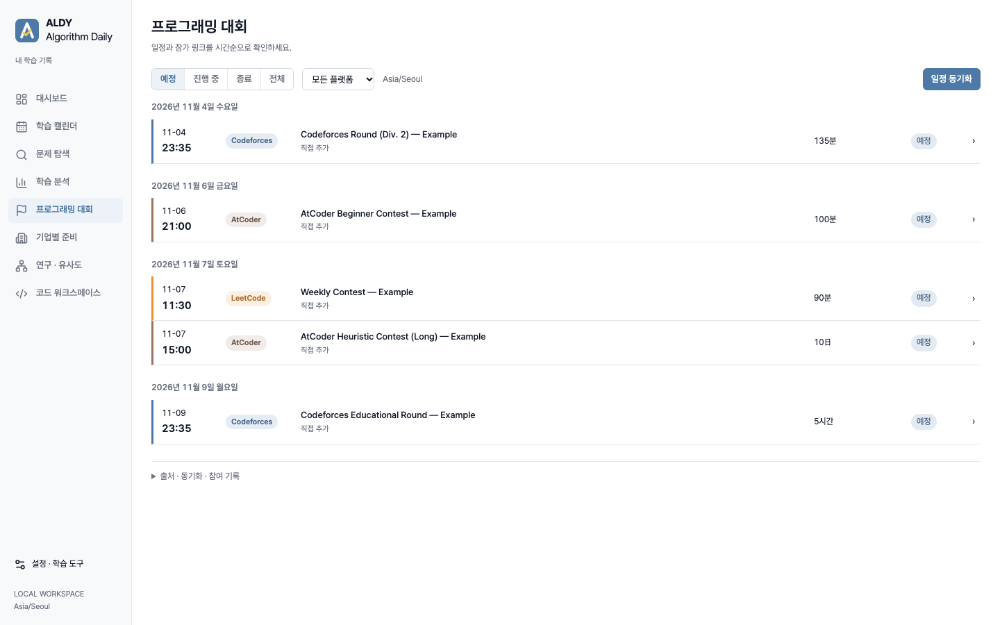
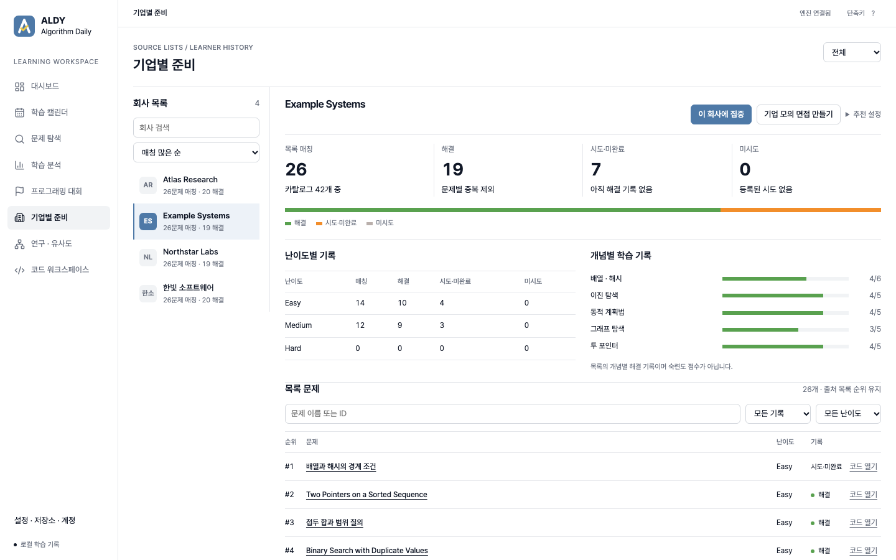
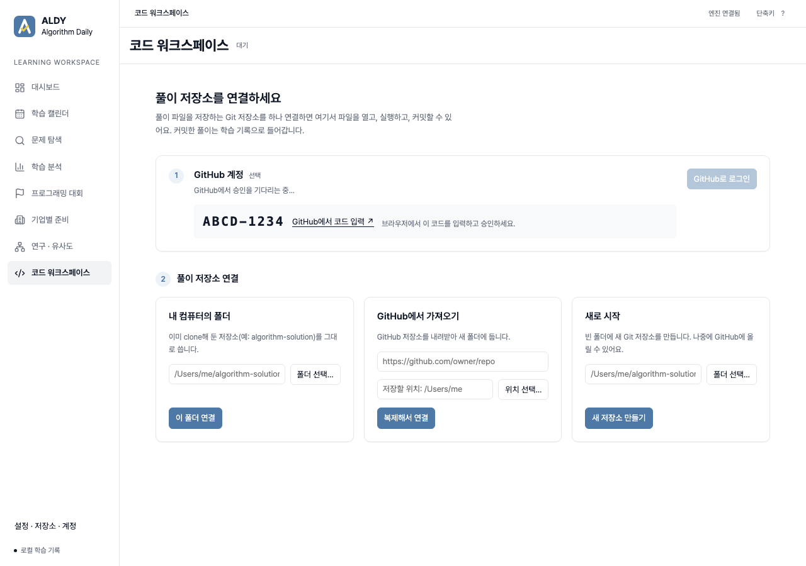
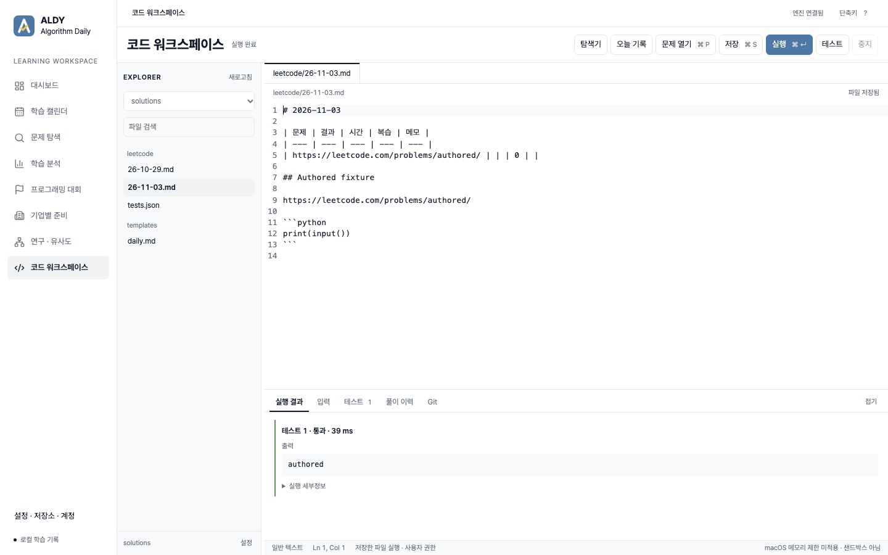

<p align="center"></p>

**ALDY**는 LeetCode · Codeforces · AtCoder 풀이 기록을 읽어 매일 무엇을 풀고 복습할지 계획해 주는 로컬 학습 앱입니다.
학습 기록은 내 컴퓨터의 SQLite와 내 Git 풀이 저장소에만 저장되며, 서버나 유료 API 없이 동작합니다.

## 다운로드

| 플랫폼 | 파일 | 상태 |
|---|---|---|
| macOS (Apple Silicon) | [**ALDY-macos-arm64.dmg**](https://github.com/Hun-Bot2/Algorithm-RAG-Engine/releases/latest/download/ALDY-macos-arm64.dmg) | 미리보기 빌드 (서명 없음) |
| Windows (.exe) | 준비 중 | Windows에서 빌드·검증 전 |

모든 버전은 [Releases](https://github.com/Hun-Bot2/Algorithm-RAG-Engine/releases)에 있습니다.

**설치:** `.dmg`를 열고 `ALDY`를 `Applications` 폴더로 끌어 옮깁니다.

**처음 열 때 (서명 없는 앱):** 응용 프로그램 폴더에서 `ALDY`를 **Control-클릭 → 열기**를 누릅니다.
그래도 막히면 터미널에서 다음을 한 번 실행합니다.

```sh
xattr -dr com.apple.quarantine /Applications/ALDY.app
```

## 사용법

1. **ALDY를 엽니다.** 첫 실행에서 "새로 시작"을 고르거나, 이미 쓰던 학습 기록(SQLite)을 복사해 옵니다.
2. **코드 워크스페이스에서 풀이 저장소를 연결합니다.**
   GitHub로 로그인(선택)한 뒤 내 저장소를 고르거나, 컴퓨터에 있는 폴더를 연결하거나, 새 저장소를 만듭니다.
3. **매일 학습 일지를 씁니다.** "오늘 기록"을 누르면 `leetcode/YY-MM-DD.md`가 열립니다. "문제 열기(⌘P)"로 문제를 추가하고, 코드 블록에 풀이를 쓴 뒤 실행해 봅니다.
   다 풀면 표의 결과 칸에 `1`(해결) 또는 `0`(미해결)을 적습니다.

   ```md
   | Problem | Result | Time | Review | Memo |
   | --- | --- | --- | --- | --- |
   | https://leetcode.com/problems/two-sum/ | 1 | 12m | 0 | hash map |
   ```
   한국어 머리글(`| 문제 | 결과 | 시간 | 복습 | 메모 |`)도 똑같이 읽습니다.
4. **Git 패널에서 커밋합니다.** 커밋한 일지가 학습 기록으로 들어가고, 대시보드에 다음 계획과 복습이 나옵니다. Push는 직접 누를 때만 합니다.
5. **대시보드와 캘린더에서 오늘 할 일을 확인합니다.** 대회 일정, 기업별 문제 목록, 학습 분석도 같은 앱에서 볼 수 있습니다.

일지 형식의 자세한 규칙은 [학습 일지 안내](specs/mastery-journal/runbook.md)에 있습니다.

> 아래 스크린샷은 모두 테스트용으로 만든 가짜 데이터입니다. 문제·회사·대회 이름은 예시이며 실제 학습 기록이 아닙니다.

## 화면 설명

### 대시보드



- 오늘 해결·오늘 시도·기한 지난 항목·복습 대상 숫자를 한 줄로 보여 주고, 숫자마다 한 줄 설명을 붙였습니다.
- **오늘의 계획**과 **복습 대기**는 추천 엔진이 내 기록으로 고른 문제입니다. 지난 계획에서 풀지 못한 문제는 "기한 지남"으로 넘어옵니다.
- 오른쪽에는 최근 14일 시도/해결, 다음 대회, 최근 활동이 있습니다. **학습 이어가기**는 다음 문제를 코드 워크스페이스에서 엽니다.

### 학습 캘린더



- 날짜 칸마다 해결·시도·예정·복습·대회를 색 점으로 표시합니다. 날짜를 누르면 그날의 기록이 오른쪽 패널에 열립니다.
- 오른쪽 요약은 오늘과 이번 달의 해결 문제·시도·기록한 날, 연속 기록, 최근 8주 시도 히트맵입니다. 계획·복습·대회는 세지 않고 풀이 기록만 셉니다.

### 문제 탐색



- 전체 카탈로그(세 플랫폼)와 내 풀이 기록을 한곳에서 검색합니다. 난이도는 플랫폼 고유 척도(LeetCode Easy/Medium/Hard, Codeforces·AtCoder 레이팅) 그대로 둡니다.

### 학습 분석



- 해결 문제·전체 시도·활동일·직접 기록한 시간·해결 비율, 1년 활동 지도, 날짜별 시도와 해결, 난이도·주제별 분포를 보여 줍니다.
- 모든 숫자는 실제 기록에서 계산하고, 원본 시도로 내려가 볼 수 있습니다. 해결 비율은 결과를 적은 시도만 분모에 넣습니다.

### 프로그래밍 대회



- 대회를 날짜별로 묶고, 플랫폼을 색 띠와 이름표(Codeforces 파랑, AtCoder 갈색, LeetCode 주황)로, 상태를 예정·진행 중·종료·참여함 이름표로 구분합니다.
- 진행 시간은 240분까지는 분, 그보다 길면 시간, 24시간 이상은 `10日`처럼 일(日)로 씁니다.
- 공식 일정을 동기화하거나 직접 추가할 수 있습니다. 대회마다 "나에게 맞는지" 판정은 하지 않습니다.

### 기업별 준비



- 회사별 LeetCode 문제 목록과 내 기록을 비교합니다. 회사는 로고 대신 이니셜로 표시하고, **매칭 많은 순 · 대기업 순 · 이름순**으로 정렬합니다.
  대기업 순은 IT 기업의 대략적인 시가총액·인지도로 직접 정한 목록이며 실시간 데이터가 아닙니다.
- 회사 목록에 있다고 실제 면접에 나온다는 뜻은 아닙니다. 수치는 "우리 카탈로그 중 회사 목록에서 찾은 비율"입니다.
- **이 회사에 집중**을 누르면 추천이 그 회사 목록 안에서 이루어지고, **기업 모의 면접**을 만들 수 있습니다.

### 코드 워크스페이스

처음 열면 풀이 저장소를 연결하는 시작 화면이 나옵니다.



1. **GitHub 계정 (선택)**: GitHub 기기 인증(device flow)으로 로그인합니다. 화면에 나온 코드를 브라우저에서 입력하면 됩니다.
   로그인 정보는 OS 키체인에만 저장됩니다. 로그인하지 않아도 컴퓨터의 Git 인증으로 가져오기와 Push가 됩니다.
2. **풀이 저장소 연결**: 이미 있는 폴더 연결, GitHub에서 복제(로그인하면 내 저장소 목록에서 선택), 새로 시작(원하면 GitHub 비공개 저장소도 함께 생성) 중 하나를 고릅니다.

연결한 뒤에는 매일 쓰는 Markdown 학습 일지를 그대로 편집합니다.



- **오늘 기록**: `leetcode/YY-MM-DD.md`처럼 오늘 날짜의 일지를 엽니다. 없으면 저장소의 `templates/daily.md`로 만듭니다.
- **문제 열기 (⌘P)**: 일지 표에 문제 한 줄과 `## 문제 제목`, 빈 코드 블록을 추가합니다. 결과 칸은 비워 두며, 풀고 나서 직접 `1`(해결) 또는 `0`(미해결)을 적습니다.
- **실행 / 테스트**: 커서가 있는 Python·C++ 코드 블록을 실행합니다. 실행은 시간·출력 제한이 있지만 샌드박스는 아닙니다.
- **Git** 패널에서 고른 파일만 커밋하고, Push는 직접 누를 때만 합니다. 커밋된 일지가 학습 기록으로 들어갑니다.

## 추천은 이렇게 동작합니다

- 내 풀이 기록만으로 계획합니다. 못 푼 문제는 다음 날 우선 복습에 들어가고, Easy → Medium → 다른 문제로 옮겨 풀기 → 간격을 둔 복습 순서로 진행합니다.
- 도움을 받았는지는 기록하지 않으며, 푼 문제는 모두 해결로 셉니다([ADR 005](specs/adaptive-learning/adrs/005-solved-only-outcomes.md)).
- 추천 이유는 점수 구성 요소까지 확인할 수 있습니다. 선택 기능인 Gemini/NVIDIA 설명은 `explain` 명령을 직접 실행할 때만 호출합니다.
- 검증은 합성 학습 이력과 자동 테스트로 했습니다. 실제 학습 효과를 측정한 것은 아닙니다.

## 개발자용

```sh
# 브라우저에서 로컬 실행 (http://127.0.0.1:8787)
node hosted/cli.mjs catalog use --version catalog-v4
node hosted/local.mjs

# CLI로 풀이 기록 가져오기와 계획
node hosted/cli.mjs repo add --id solutions --path ~/algorithm-solution
node hosted/cli.mjs repo ingest
node hosted/cli.mjs journal

# 테스트
node --test hosted/test/*.test.mjs
node --test desktop/test/*.test.mjs
```

데스크톱 앱 빌드, GitHub 로그인 설정(OAuth App Client ID)은 [desktop/README.md](desktop/README.md)에 있습니다.

| 폴더 | 내용 |
|---|---|
| `hosted/` | 학습 엔진(유일한 학습 기록 작성자), 로컬 서버, 화면 |
| `desktop/` | Tauri 데스크톱 셸, 코드 워크스페이스, 로컬 실행기 |
| `specs/` | 요구사항·설계·작업·ADR (구현보다 우선) |
| `research/` | 유사도 지도 등 탐색 연구 (추천에 쓰지 않음) |
| `curriculum/`, `assets/` | 검토·해시 고정된 입력 데이터 |
| `src/learning/`, `scripts/learning/`, `tests/` | Python 표준 라이브러리 기반 도구와 테스트 |

| 영역 | 상태 | 문서 |
|---|---|---|
| 학습 엔진·일지·캘린더 | 로컬 구현, 자동 테스트 통과 | [mastery-system](specs/mastery-system/), [calendar-workspace](specs/calendar-workspace/design.md) |
| 데스크톱 앱 (Tauri) | Mac 서명 없는 빌드. Windows·서명·업데이트 설치는 미검증 | [desktop-app](specs/desktop-app/requirements.md), [새 사용자 설정](specs/desktop-app/new-user-workspace.md) |
| UI | Tableau 색 체계, 8개 메뉴 | [desktop-redesign](specs/desktop-redesign/design.md) |
| 기업별 준비 | 회사 목록 레이어(company-v2) | [company-prep](specs/company-prep/) |

이 저장소는 2026-01 Baekjoon → LeetCode 추천 파이프라인으로 시작했습니다. 백준 종료로 2026-10-18에 삭제했으며 git 태그
`legacy-pipeline-final`에서 복구할 수 있습니다. 에이전트용 저장소 규칙은 [AGENTS.md](AGENTS.md)에 있습니다.
