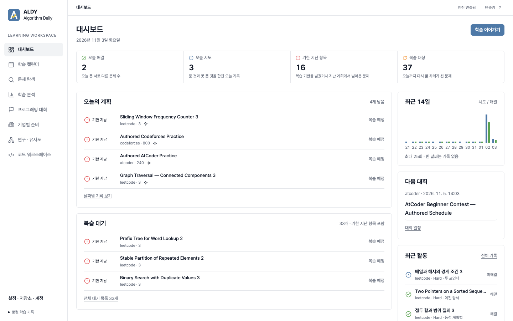
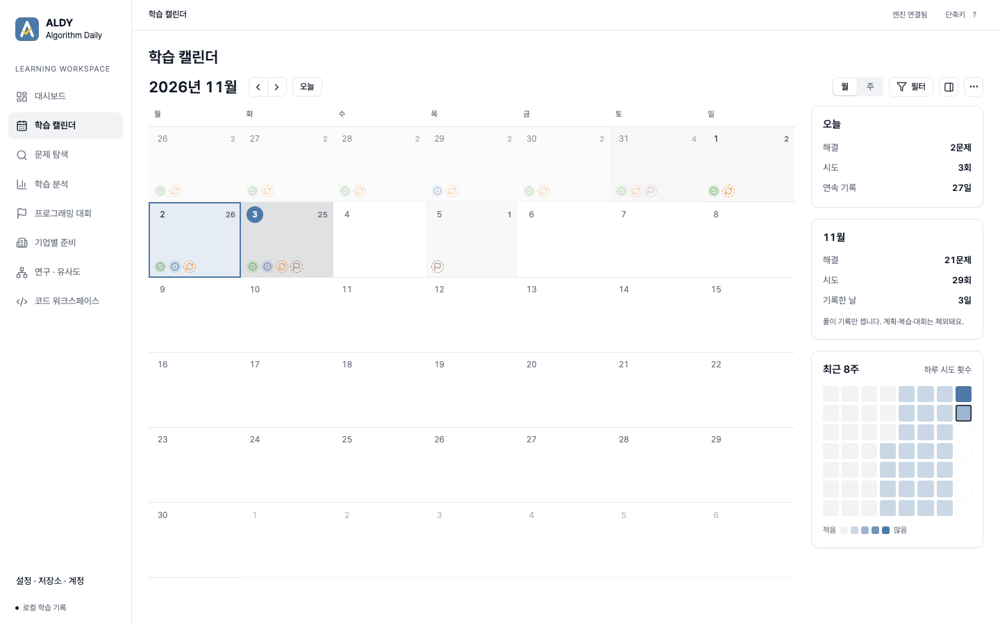
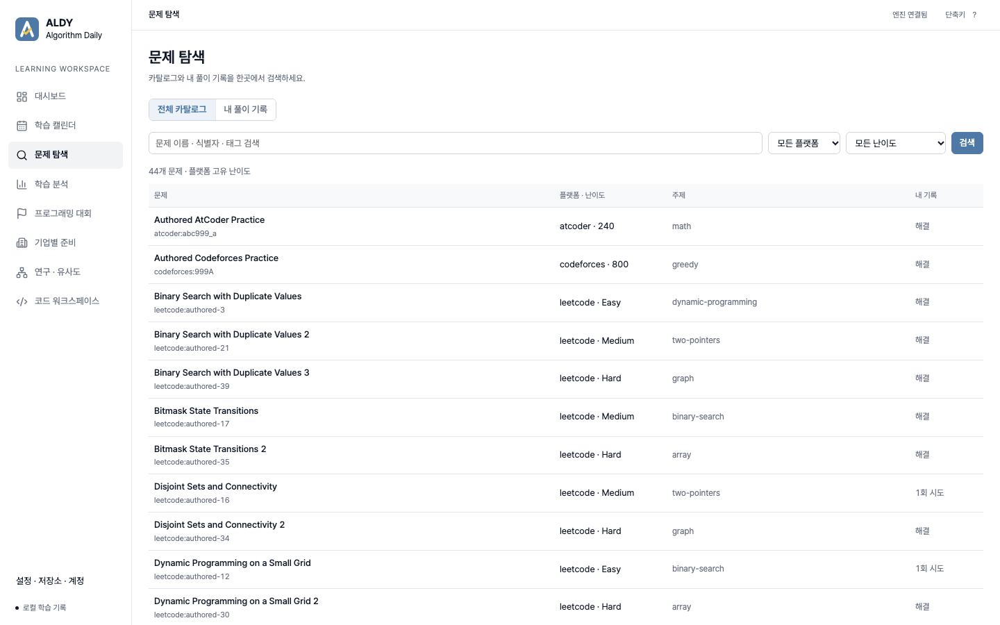
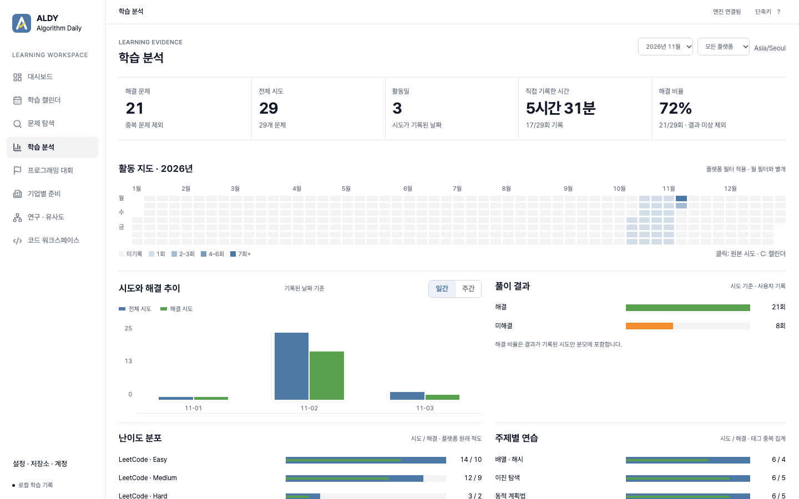
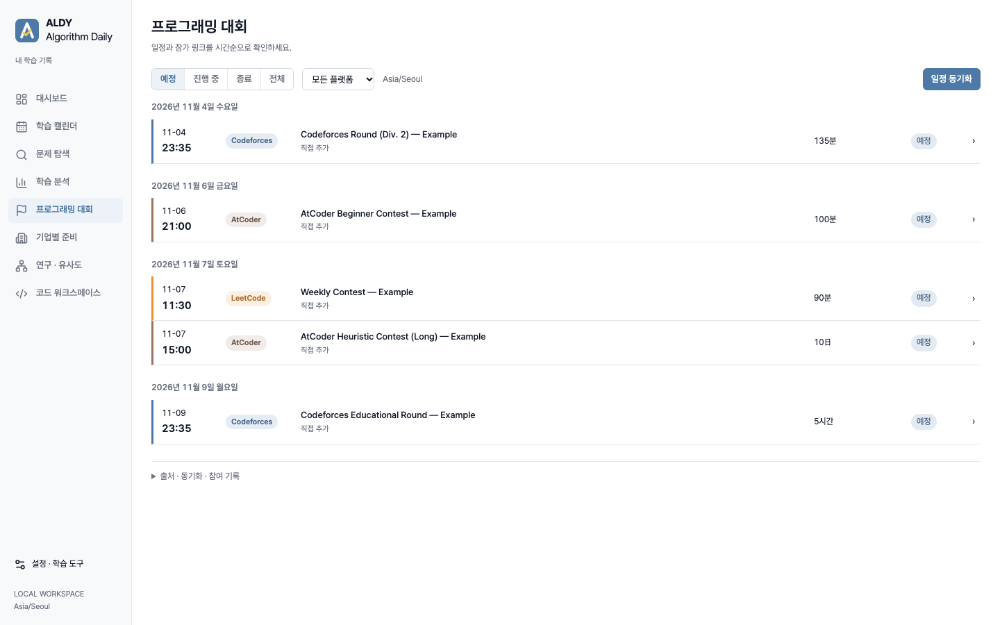
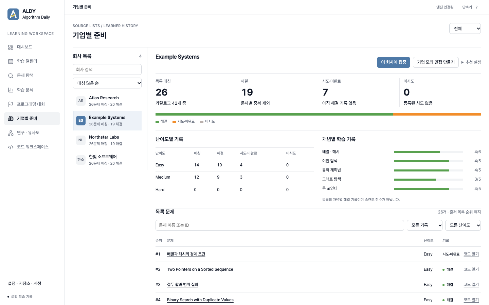
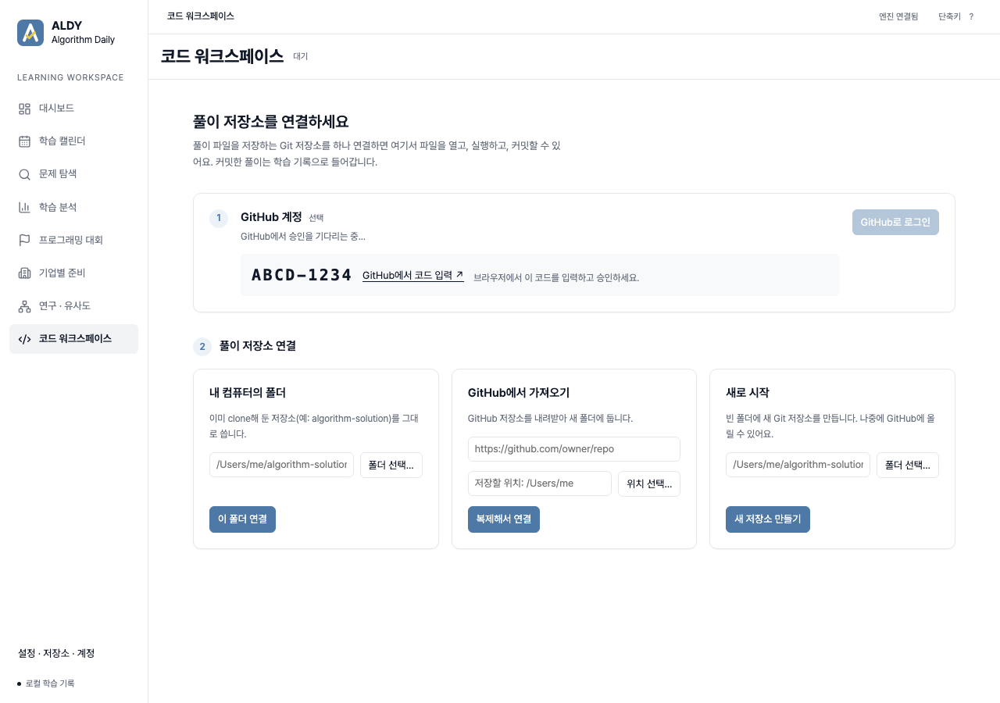
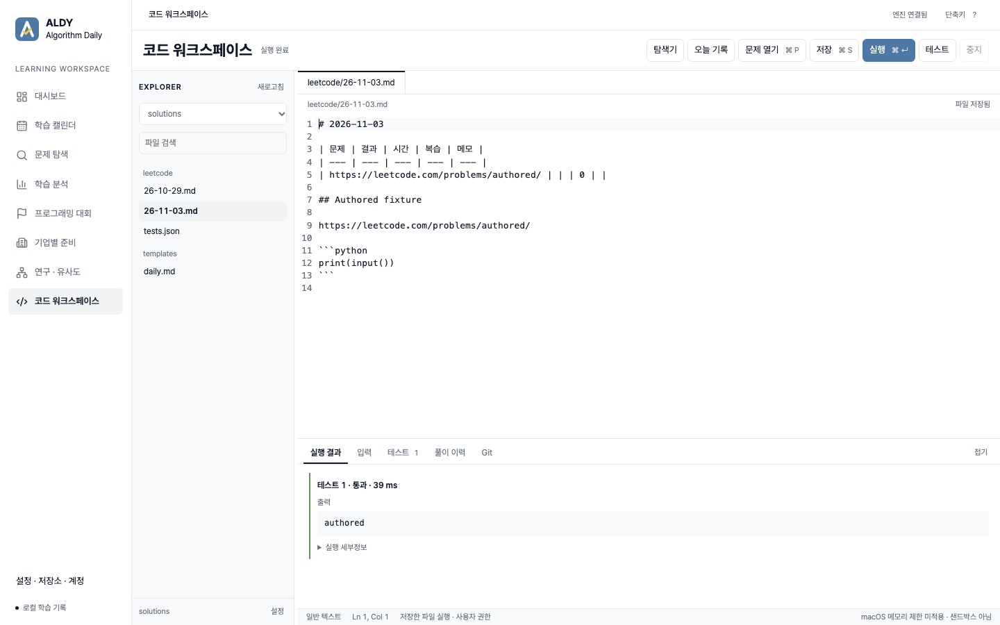

# ALDY — Algorithm Daily

LeetCode · Codeforces · AtCoder 풀이 기록을 읽어 매일 무엇을 풀고 복습할지 계획해 주는 **로컬 우선 학습 앱**입니다.
학습 기록은 내 컴퓨터의 SQLite와 내 Git 풀이 저장소에만 저장됩니다. 서버나 유료 API 없이 동작합니다.
macOS(Apple Silicon) 앱을 먼저 만들고 있으며, Windows 지원은 검증 중입니다.

> 아래 스크린샷은 모두 테스트용으로 만든 가짜 데이터입니다. 문제·회사·대회 이름은 예시이며 실제 학습 기록이 아닙니다.

## 화면 둘러보기

### 대시보드



- 오늘 해결·오늘 시도·기한 지난 항목·복습 대상 숫자를 한 줄로 보여 주고, 숫자마다 한 줄 설명을 붙였습니다.
- **오늘의 계획**과 **복습 대기**는 추천 엔진이 내 기록으로 고른 문제입니다. 지난 계획에서 풀지 못한 문제는 "기한 지남"으로 넘어옵니다.
- 오른쪽에는 최근 14일 시도/해결, 다음 대회, 최근 활동이 있습니다. **학습 이어가기**는 다음 문제를 코드 워크스페이스에서 엽니다.

### 학습 캘린더



- 날짜 칸마다 해결·시도·예정·복습·대회를 색 점으로 표시합니다. 날짜를 누르면 그날의 기록이 오른쪽 패널에 열립니다.
- 오른쪽 요약은 오늘과 이번 달의 해결 문제·시도·기록한 날, 연속 기록, 최근 8주 시도 히트맵입니다. 계획·복습·대회는 세지 않고 풀이 기록만 셉니다.

### 문제 탐색



- 전체 카탈로그(세 플랫폼)와 내 풀이 기록을 한곳에서 검색합니다. 난이도는 플랫폼 고유 척도(LeetCode Easy/Medium/Hard, Codeforces·AtCoder 레이팅) 그대로 둡니다.

### 학습 분석



- 해결 문제·전체 시도·활동일·직접 기록한 시간·해결 비율, 1년 활동 지도, 날짜별 시도와 해결, 난이도·주제별 분포를 보여 줍니다.
- 모든 숫자는 실제 기록에서 계산하고, 원본 시도로 내려가 볼 수 있습니다. 해결 비율은 결과를 적은 시도만 분모에 넣습니다.

### 프로그래밍 대회



- 대회를 날짜별로 묶고, 플랫폼을 색 띠와 이름표(Codeforces 파랑, AtCoder 갈색, LeetCode 주황)로, 상태를 예정·진행 중·종료·참여함 이름표로 구분합니다.
- 진행 시간은 240분까지는 분, 그보다 길면 시간, 24시간 이상은 `10日`처럼 일(日)로 씁니다.
- 공식 일정을 동기화하거나 직접 추가할 수 있습니다. 대회마다 "나에게 맞는지" 판정은 하지 않습니다.

### 기업별 준비



- 회사별 LeetCode 문제 목록과 내 기록을 비교합니다. 회사는 로고 대신 이니셜로 표시하고, **매칭 많은 순 · 대기업 순 · 이름순**으로 정렬합니다.
  대기업 순은 IT 기업의 대략적인 시가총액·인지도로 직접 정한 목록이며 실시간 데이터가 아닙니다.
- 회사 목록에 있다고 실제 면접에 나온다는 뜻은 아닙니다. 수치는 "우리 카탈로그 중 회사 목록에서 찾은 비율"입니다.
- **이 회사에 집중**을 누르면 추천이 그 회사 목록 안에서 이루어지고, **기업 모의 면접**을 만들 수 있습니다.

### 코드 워크스페이스

처음 열면 풀이 저장소를 연결하는 시작 화면이 나옵니다.



1. **GitHub 계정 (선택)**: GitHub 기기 인증(device flow)으로 로그인합니다. 화면에 나온 코드를 브라우저에서 입력하면 됩니다.
   로그인 정보는 OS 키체인에만 저장됩니다. 로그인하지 않아도 컴퓨터의 Git 인증으로 가져오기와 Push가 됩니다.
2. **풀이 저장소 연결**: 이미 있는 폴더 연결, GitHub에서 복제(로그인하면 내 저장소 목록에서 선택), 새로 시작(원하면 GitHub 비공개 저장소도 함께 생성) 중 하나를 고릅니다.

연결한 뒤에는 매일 쓰는 Markdown 학습 일지를 그대로 편집합니다.



- **오늘 기록**: `leetcode/YY-MM-DD.md`처럼 오늘 날짜의 일지를 엽니다. 없으면 저장소의 `templates/daily.md`로 만듭니다.
- **문제 열기 (⌘P)**: 일지 표에 문제 한 줄과 `## 문제 제목`, 빈 코드 블록을 추가합니다. 결과 칸은 비워 두며, 풀고 나서 직접 `1`(해결) 또는 `0`(미해결)을 적습니다.
- **실행 / 테스트**: 커서가 있는 Python·C++ 코드 블록을 실행합니다. 실행은 시간·출력 제한이 있지만 샌드박스는 아닙니다.
- **Git** 패널에서 고른 파일만 커밋하고, Push는 직접 누를 때만 합니다. 커밋된 일지가 학습 기록으로 들어갑니다.

## 시작하기

**데스크톱 앱 (macOS, 서명 없는 빌드)**: 빌드와 실행 방법은 [desktop/README.md](desktop/README.md)에 있습니다.
GitHub 로그인을 쓰려면 한 번만 GitHub OAuth App을 등록해 Client ID를 넣어야 합니다(같은 문서의 "GitHub sign-in").

**브라우저에서 로컬 실행**:

```sh
# 아직 카탈로그를 선택하지 않았다면 최초 1회
node hosted/cli.mjs catalog use --version catalog-v4
node hosted/local.mjs
# http://127.0.0.1:8787
```

**풀이 기록 가져오기와 계획 (CLI)**:

```sh
node hosted/cli.mjs repo add --id solutions --path ~/algorithm-solution
node hosted/cli.mjs repo ingest
node hosted/cli.mjs journal
```

풀이 저장소의 날짜별 일지 형식은 표 `| 문제 | 결과 | 시간 | 복습 | 메모 |` 한 줄에 문제 하나입니다. 자세한 규칙은
[학습 일지 안내](specs/mastery-journal/runbook.md)에 있습니다.

## 추천은 이렇게 동작합니다

- 내 풀이 기록만으로 계획합니다. 못 푼 문제는 다음 날 우선 복습에 들어가고, Easy → Medium → 다른 문제로 옮겨 풀기 → 간격을 둔 복습 순서로 진행합니다.
- 도움을 받았는지는 기록하지 않으며, 푼 문제는 모두 해결로 셉니다([ADR 005](specs/adaptive-learning/adrs/005-solved-only-outcomes.md)).
- 추천 이유는 점수 구성 요소까지 확인할 수 있습니다. 선택 기능인 Gemini/NVIDIA 설명은 `explain` 명령을 직접 실행할 때만 호출합니다.
- 검증은 합성 학습 이력과 자동 테스트로 했습니다. 실제 학습 효과를 측정한 것은 아닙니다.

## 현재 상태와 문서

| 영역 | 상태 | 문서 |
|---|---|---|
| 학습 엔진·일지·캘린더 | 로컬 구현, 자동 테스트 통과 | [mastery-system](specs/mastery-system/), [calendar-workspace](specs/calendar-workspace/design.md) |
| 데스크톱 앱 (Tauri) | Mac 서명 없는 빌드 실행 확인. Windows·서명·업데이트 설치는 미검증 | [desktop-app](specs/desktop-app/requirements.md), [새 사용자 설정](specs/desktop-app/new-user-workspace.md) |
| UI 재설계 | Tableau 색 체계, 8개 메뉴 | [desktop-redesign](specs/desktop-redesign/design.md) |
| 기업별 준비 | 회사 목록 레이어(company-v2) | [company-prep](specs/company-prep/) |
| 연구 | 24,297문제 제목 유사도 지도, 언어 편향, AtCoder 개념 분류 (탐색용, 추천에 쓰지 않음) | `research/*/REPORT.md` |

- 초기 Baekjoon → LeetCode 추천 파이프라인은 백준 종료로 입력을 잃어 2026-10-18에 삭제했고, git 태그 `legacy-pipeline-final`에서 복구할 수 있습니다.
- 에이전트용 저장소 규칙은 [AGENTS.md](AGENTS.md)에 있습니다.

## 초기 파이프라인 기록 (2026-01, 삭제됨)

아래 내용은 2026-01 시점의 초기 파이프라인 기록입니다.

---

백준 풀이 기록을 분석해 유사한 LeetCode 문제를 자동 추천하고, 매일 07:00 KST에 Slack으로 알림을 보냅니다.

## 아키텍처 개요
- Heavy Job (`src/main/generate_index_map.py`):
	- Baekjoon MDX → OpenAI 임베딩(text-embedding-3-small) → Numpy(LeetCode 인덱스) 유사도 검색 → GPT-4o-mini로 추천 이유 생성 → `artifacts/recommendation_map.json` 저장
- Light Job (`src/main/slack_bot_daily_review.py`):
	- JSON 로드 → Slack Webhook으로 메시지 전송
- GitHub Actions: 워크플로우 삭제됨(2026-10-18). 이전에는 수동 실행(workflow_dispatch)만 지원했습니다.
- S3 사용(워크플로우에서만):
	- Job1: `aws s3 sync ./artifacts s3://hunbot-algo-rag-data/ --delete`
	- Job2: `aws s3 cp s3://hunbot-algo-rag-data/recommendation_map.json .`

## 프로젝트 개요
본 프로젝트는 개인 학습용 백준 알고리즘 풀이 기록(MDX)을 기반으로, OpenAI의 Embedding 모델과 Numpy 벡터 DB를 활용하여 가장 유사한 LeetCode 문제를 추천해주는 RAG(Retrieval-Augmented Generation) 시스템을 구축하는 것을 목표로 했습니다. 
단순한 추천에 그치지 않고 매일 자동으로 실행되어 슬랙으로 알림을 보내는 자동화된 파이프라인을 설계했습니다.

## 시스템 아키텍처 및 주요 기술 스택

* CI/CD 및 트리거: GitHub Actions를 사용하여 매일 정해진 시간에 파이프라인이 구동되도록 설정했습니다.
* 컨테이너화: 환경 격리와 의존성 관리를 위해 Docker를 사용했으며, 연산량이 많은 Heavy Job과 알림 전송용 Light Job으로 스테이지를 분리하여 효율성을 높였습니다.
* 데이터 적재 및 검색: LangChain 프레임워크를 기반으로 Numpy를 사용해 유사도 검색을 수행합니다.
* AI 모델: text-embedding-3-small 모델로 벡터화하고, gpt-4o-mini 모델을 통해 추천 사유를 생성합니다.

* 아티팩트 저장소: AWS S3를 중앙 저장소로 활용하여 대용량 인덱스 파일과 생성된 결과물(JSON)을 관리합니다.
* 모니터링: LangSmith를 연동하여 LLM의 추론 과정을 추적하고 품질을 관리합니다.

## 주요 기술적 과제와 해결 방안

* **Docker 이미지 빌드 시간 단축 및 최적화**: 초기에는 매 실행 시마다 PyTorch와 FAISS 같은 무거운 라이브러리를 설치하여 빌드 시간이 10분 이상 소요되는 문제가 있었습니다. → NumPy로 변경하고 더 속도가 빨라졌습니다.

이를 해결하기 위해 **GitHub Container Registry(GHCR)**를 도입하여 이미지를 사전에 빌드해두고, 실행 시에는 `docker pull`만 수행하도록 변경했습니다. 또한, GPU가 없는 CI 환경에 맞춰 **FAISS → NumPy 기반 벡터 검색**으로 전환하여 이미지 크기를 획기적으로 줄였습니다.

* **대용량 바이너리 파일 관리**: FAISS 인덱스 파일은 Git으로 관리하기에 부적절하여 **AWS S3**를 원본 저장소로 지정했습니다. -> Numpy로 바꾼 .npy, json파일도 **AWS S3**를 사용합니다.

GitHub Actions 실행 시점에만 S3에서 인덱스를 다운로드하고 Docker 볼륨으로 마운트하는 **하이브리드 스토리지 전략**을 통해 보안과 접근성을 모두 확보했습니다.

* **불필요한 중복 연산 제거**: 매번 모든 알고리즘 문제 파일을 다시 임베딩하는 비효율을 개선하기 위해, **GitPython**을 활용하여 가장 최근 커밋(`HEAD`)에서 변경된 파일만 감지하여 처리하는 로직을 구현했습니다. 이를 통해 API 호출 비용을 절감하고 처리 속도를 극대화했습니다.

## 최종 워크플로우 흐름

* **GitHub Actions 스케줄러**가 작동하여 워크플로우를 시작합니다.
* **GHCR**에서 사전에 빌드된 최적화된 Heavy Job 이미지를 다운로드(Pull)하고, **S3**에서 NumPy 인덱스를 가져옵니다.
* **Heavy Job 컨테이너**가 실행되며 Git 히스토리를 분석해 **최신 커밋된 알고리즘 문제 파일만 선별**합니다.
* 선별된 문제에 대해 임베딩 및 유사도 검색을 수행하고, 추천 결과(JSON)를 **S3**에 업로드(Sync)합니다.
* **Light Job 컨테이너**가 S3에서 JSON을 받아 Slack API를 통해 지정한 형식의 시각화된 메시지를 전송합니다.

### 최적화 성과

* **실행 시간 단축**: 사전 빌드 이미지 도입과 의존성 최적화를 통해 전체 파이프라인 실행 시간을 초기 약 12분에서 **2분 미만**으로 80% 이상 단축했습니다.
* **비용 절감**: 변경된 파일만 처리하는 로직을 통해 OpenAI API 호출 비용을 최소화했습니다.

### 향후 발전 방향

- 현재는 고정된 LeetCode 인덱스를 사용하고 있으나, 향후에는 새로운 문제가 추가될 때마다 인덱스를 자동으로 갱신하는 파이프라인을 추가할 계획입니다. 또한 슬랙 메시지에 인터랙티브 버튼을 도입하여 사용자 피드백을 수집하고, 이를 기반으로 추천 정확도를 높이는 루프를 구상 중입니다.
- Python 코드 내부의 병렬 처리 (Parallelism) 기법을 도입하여 대량의 알고리즘 문제를 동시에 처리하는 기능도 검토하고 있습니다. -> 공부한 뒤 적용할 계획입니다.
- 다른 사용자들이 사용할 수도 있어서(?) 최대한 범용적으로 바꿔보려고 합니다.

## 주요 파일 (초기 파이프라인, 삭제됨: 태그 `legacy-pipeline-final`)
- `src/main/generate_index_map.py` — Baekjoon MDX → OpenAI 임베딩 → NumPy 검색 → GPT-4o-mini 이유 → JSON 저장
- `src/main/slack_bot_daily_review.py` — JSON 로드 → Slack Webhook 알림
- `Dockerfile` — heavy/light 멀티스테이지 빌드 (heavy:  NumPy+LangChain, light: Slack 최소 의존성)
- `.github/workflows/daily_algorithm_pipeline.yml` — 삭제됨(2026-10-18, git 이력 참고)
- `indexes/faiss_leetcode/ → indexes/numpy_leetcode/` — 사전 구축된 LeetCode → NumPy 인덱스 (필수)
- `artifacts/recommendation_map.json` — 생성된 추천 맵 (S3 업로드 대상)

---

아래 내용은 해당 알고리즘 앱을 범용적으로 만들게 되면, 바꿀 부분입니다. 지금은 개인으로 사용하기에 불편함이 없습니다..

### GitHub Repository Secrets 설정
Repository Settings → Secrets and variables → Actions → New repository secret에서 다음 키들을 추가:

| Secret 이름 | 설명 | 획득 방법 |
|------------|------|----------|
| `OPENAI_API_KEY` | OpenAI API 키 (임베딩 + GPT-4o-mini) | [OpenAI Platform](https://platform.openai.com/api-keys) |
| `SLACK_WEBHOOK_URL` | Slack Incoming Webhook URL | [Slack App 설정](https://api.slack.com/messaging/webhooks) |
| `AWS_ACCESS_KEY_ID` | AWS S3 접근용 액세스 키 ID | AWS IAM 사용자 생성 → Access Key 발급 |
| `AWS_SECRET_ACCESS_KEY` | AWS S3 시크릿 액세스 키 | 위와 동일 |
| `LANGSMITH_API_KEY` | LangSmith 추적용 API 키 (선택) | [LangSmith 설정](https://smith.langchain.com/) |


**Last Updated**: 2026-01-15

## Adaptive learning foundation (M1-M3)

The new private learning product has a mandatory no-AI core, separate from the
legacy batch pipeline above. Its [specifications](specs/adaptive-learning/requirements.md),
[architecture](specs/adaptive-learning/design.md) and
[milestones](specs/adaptive-learning/tasks.md) define the migration boundary.
Local append-only learner events, explicit confirmed timers and JSON restore now
use standard-library SQLite; see [local usage](specs/adaptive-learning/local-history.md).
[Asset manifests](assets/README.md) preserve originals and exclude unreviewed data
from hosted bundles. Run `python3 -m unittest discover -s tests -v` and
`python3 scripts/learning/assets.py verify` offline.

This foundation does not yet generate adaptive missions or supply a hosted mobile
dashboard, reviewed curriculum or new Slack transport. Deployment, schedules,
public registration and optional model training remain gated. Existing production
jobs retain their current OpenAI dependency and manual workflow trigger.


## Private adaptive pilot implementation

The no-AI pilot now includes a reviewed 90-problem curriculum, deterministic
practice/review/transfer policy, configurable weekly rhythm, mobile dashboard,
explicit study intervals and contest records, private backups and a durable
Slack outbox. Worker/D1/Access deployment code and local verification tools are
under [hosted/](hosted/); start with [deployment instructions](specs/adaptive-learning/deployment.md).
The existing batch production application is unchanged.

Local checks cover Python/Node, actual Chrome mobile flows and local workerd/D1.
The service is not deployed and Slack/schedules remain disabled pending account,
identity and destination selection. The optional [research tools](specs/adaptive-learning/research-contract.md)
retain sparse-label limitations and prevent current evaluation data from training
a model. No trained model, 30-day delivery result or learning benefit is claimed.
